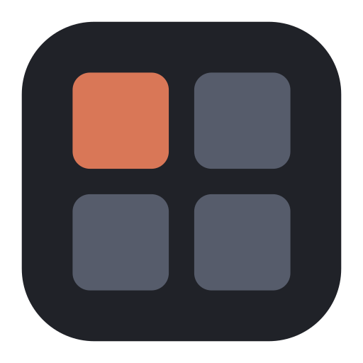
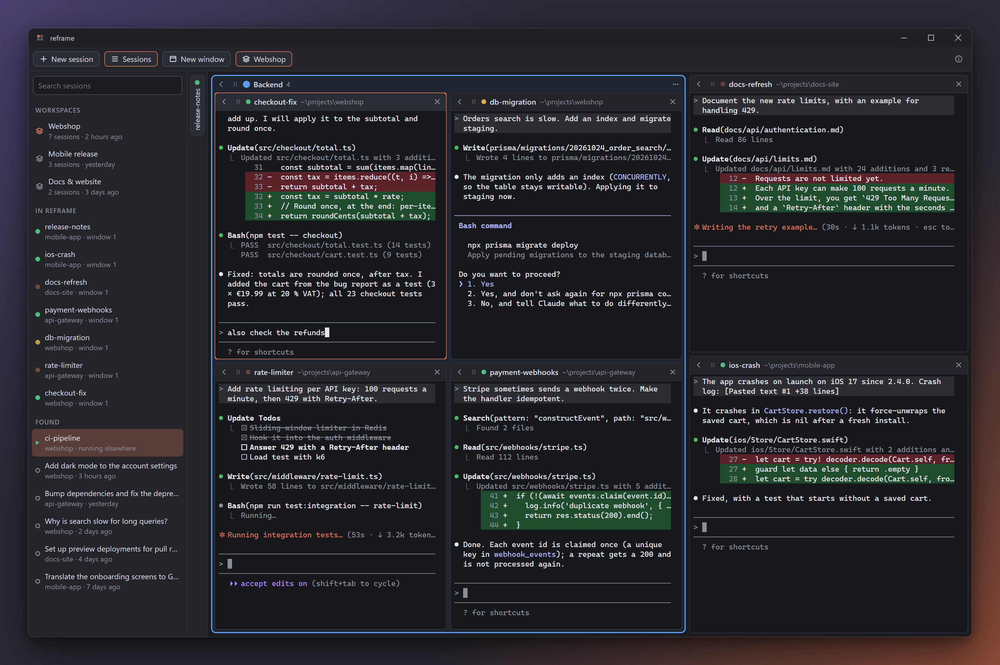
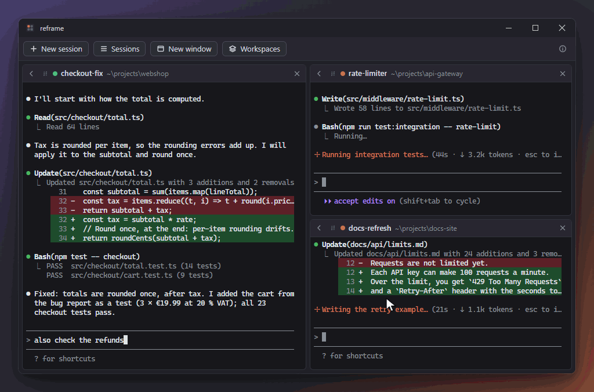
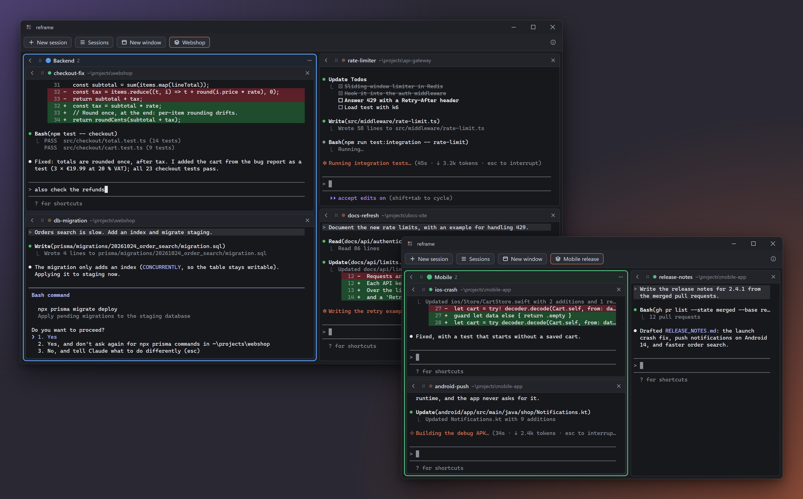
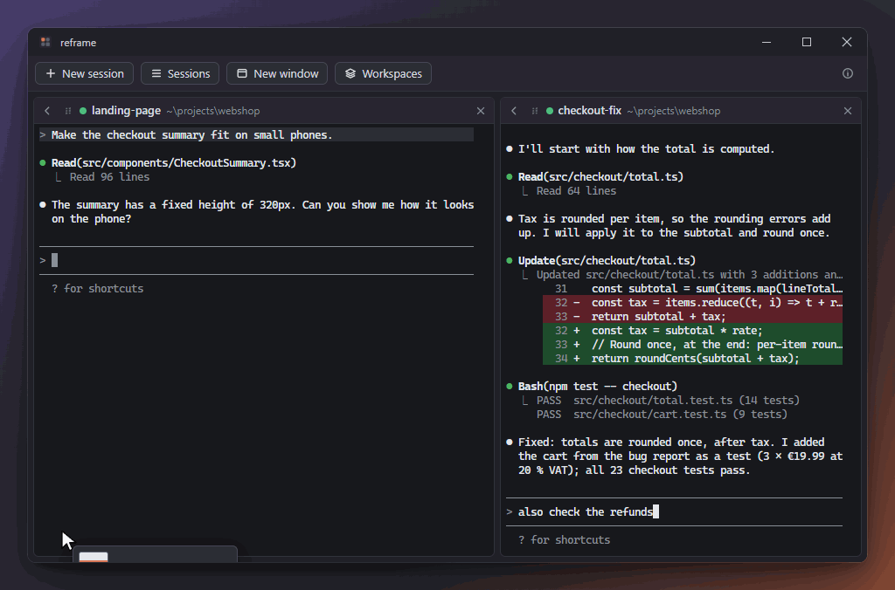
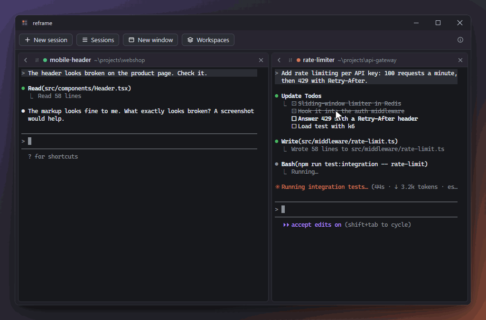

<p align="center">
  
</p>

<h1 align="center">reframe</h1>

<p align="center">
  Keep your <a href="https://claude.com/claude-code">Claude Code</a> sessions side by side in one window: tile and group them,<br>
  take over the ones running in other terminals, and get every session back after a restart.
</p>

<p align="center">
  <a href="https://theycallmejuzou.github.io/reframe/">Website</a> ·
  <a href="https://theycallmejuzou.github.io/reframe/download.html">Download</a>
</p>

<p align="center">
  
  <br>
  <sub>The pictures show made-up projects and sessions.</sub>
</p>

---

reframe 1.0 is a native Windows app (Rust, no web view): it starts in a fraction of a second and needs a fraction
of the memory of the 0.x versions, which were built with Electron. macOS and Linux stay on
[0.10](https://github.com/TheyCallMeJuzou/reframe/releases?q=v0.10) for now.

## What it does

- **All sessions in view.** Every session is a tile, and all tiles are visible at once, in two columns that fill in turn. Drag a tile's header onto another tile's edge to split next to it; the drop zone shows where it lands. Separators snap to a grid over the window as you drag them, so tiles line up (hold Alt to place one freely, or turn it off in Settings).

  

- **Out of the way when you want.** The arrow in a tile's corner collapses it into the side bar; a click puts it back where it was.
- **Groups.** Put tiles into a group (right-click a tile, or drag it onto a group): a colored frame with a name. A tile right next to the group stays where it is, and the frame grows around it. A group collapses, moves and leaves the window as one; dissolve it or end all its sessions from its menu.
- **Several windows.** Open a new, empty window (toolbar, tray or Ctrl+Shift+N), or drag a tile or a group out of the window and it gets a window of its own; drag it back, or into another window, whenever you like. A window that is still empty when you quit is not brought back on the next start.
- **Workspaces.** Save a window under a name (Workspaces in the toolbar) and open it again later, as a window of its own with its tiles, groups and sessions, from the toolbar, the tray or the session list. F11 takes a window to full screen.

  

- **Session list.** The side bar on the left lists the sessions in reframe, the ones running in other terminals and your recent Claude Code sessions, with search, each with when it was last used (the most recent first). Click or drag one to open it: ended sessions resume, and sessions running elsewhere are taken over (ended there, continued here, history and name included). Select several with Shift or Ctrl+click and open them together from the right-click menu, also as a new group, here or in a new window. Sessions that turn up while reframe runs light up, and the Sessions button gets a dot while the list is hidden.
- **Pull terminal windows in.** Drag a Windows Terminal or console window (or just a tab of it) with a running `claude`, on Windows or in WSL, onto reframe: it shows where the session would go, and after a short confirmation the session continues in reframe, at the spot you dropped it; the terminal tab closes if nothing else runs in it.
- **WSL.** Start a session in a folder inside WSL (_Browse…_ → Linux, or type `\\wsl.localhost\Ubuntu\home\…`) and it runs the Claude Code installed in that distribution, shown as `Ubuntu ~/project`, with its status, notifications and resume after a restart like any other. Dropped files and pasted screenshots come in as Linux paths. The session list shows the sessions of running distributions too, past ones and ones running in a WSL terminal (taken over like any other); a distribution with Claude Code that is not running says so there, with a button to start it.
- **Files and screenshots.** Drop files onto a session to type in their paths (Claude Code attaches images among them), also a picture dragged out of a browser; Ctrl+V (or a right-click) pastes text, files you copied in Explorer, or a screenshot from the clipboard.

  

  

- **Nothing gets lost.** Every change is saved right away. Quitting from the tray ends the sessions cleanly, and the next start resumes each one (`claude --resume`) in its folder, in its place.
- **Runs in the background.** Closing a window with sessions asks whether to end them or keep them working in the tray (or does what you chose in Settings). In the tray they keep working, and you get a notification when Claude is done or needs you, unless you are looking at it anyway. A window's title says how many of its sessions need you (its taskbar button gets a badge, and flashes when one starts waiting unseen), the tray says how many in all, and Ctrl+Shift+Space takes you to the next one.
- **Starts with the system** if you like (Settings), quietly in the tray, and **updates itself** from GitHub Releases.
- **Settings** (the ⚙ in the toolbar, or Ctrl+,): the language (English or German, or the system's), the text size, snapping to the grid, what closing a window with sessions does, starting with the system, which Claude Code runs (the one on the PATH, or one you choose: handy with more than one installed), the model and permission mode new sessions start with, and checking for updates.

## Keyboard shortcuts

Everything else goes to Claude Code as usual.

| Shortcut               | What it does                                                                                             |
| ---------------------- | -------------------------------------------------------------------------------------------------------- |
| Ctrl+1 … 9             | Focus the first … ninth tile in the window                                                               |
| Ctrl+Shift+Arrow keys  | Focus the neighboring tile in that direction                                                             |
| Ctrl+Shift+M           | Collapse the focused tile; without a focused tile, bring back the last one                               |
| Ctrl+Shift+L           | Show or hide the session list (and search it)                                                            |
| Ctrl+Shift+Space       | Go to the next session that needs you (in this window first, then in the others)                         |
| Ctrl+Shift+F           | Find in the focused tile's terminal, its scrollback too (Enter: next, Shift+Enter: previous, Esc: close) |
| Ctrl+Shift+Z           | Let the focused tile fill the window, and back (the layout stays as it is)                               |
| Ctrl+Shift+T           | New session                                                                                              |
| Ctrl+Shift+N           | New window                                                                                               |
| F11                    | Full screen on and off                                                                                   |
| Ctrl+,                 | Settings                                                                                                 |
| Ctrl+= (or +) / Ctrl+- | Larger / smaller text in all terminals (also Ctrl+mouse wheel over a tile); Ctrl+0: back to normal       |
| Ctrl+C / Ctrl+V        | Copy the selection (otherwise Ctrl+C goes to Claude) / paste text, copied files or an image              |
| Right-click            | Copy the selection, otherwise paste (like Ctrl+V); in Claude Code's fullscreen mode: Shift+right-click   |

## Install

Download reframe from the [website](https://theycallmejuzou.github.io/reframe/download.html) or [Releases](https://github.com/TheyCallMeJuzou/reframe/releases). You need Windows 10 or 11 and [Claude Code](https://claude.com/claude-code) installed and logged in (`claude` on your `PATH`); sessions in a WSL folder use the Claude Code installed in that distribution instead.

The builds are not code-signed yet, so the first start needs a confirmation:

- **Windows** (`reframe-Setup-<version>.exe`): installs for your user without admin rights. If SmartScreen warns, choose _More info_ → _Run anyway_. An installed 0.x updates to 1.0 by itself, keeping your sessions, windows, settings and shortcuts.
- **Windows, portable** (`reframe-<version>-win-portable.zip`): unpack it anywhere (a USB stick, say) and start `reframe.exe`. It keeps its sessions, windows and settings in the folder `data` next to it and runs apart from an installed reframe. Both use the same Claude Code, though: sessions one of them runs show in the other as running elsewhere, and opening one there takes it over (after asking). It does not update itself: it tells you when there is a new version to download. If you let it start with the system and move the folder later, turn that on again. Before unpacking, right-click the ZIP → _Properties_ → tick _Unblock_: otherwise Windows marks every unpacked file as downloaded, and SmartScreen asks on the first start.
- **macOS and Linux**: reframe 0.10 (the Electron version), from its [release](https://github.com/TheyCallMeJuzou/reframe/releases?q=v0.10). It does not update to 1.0.

### Uninstall

If you let reframe start with the system, the uninstaller takes it out again. reframe never changes Claude Code's own settings files, so there is nothing to undo there.

- **Windows**: _Settings_ → _Apps_ → _Installed apps_ → reframe → _Uninstall_. Your sessions, windows and settings stay in `%APPDATA%\reframe`; delete that folder to remove them too.
- **Windows, portable**: quit reframe and delete its folder (its data is inside).
- **macOS and Linux** (0.10): see the [0.10 README](https://github.com/TheyCallMeJuzou/reframe/tree/v0.10.0#uninstall).

## Code signing policy

The Windows releases are going to be signed through the SignPath Foundation's free code signing for open source projects (being set up; until then they are unsigned, see [Install](#install)).

Free code signing provided by [SignPath.io](https://about.signpath.io/), certificate by [SignPath Foundation](https://signpath.org/).

- **What gets signed**: the Windows installer and `reframe.exe` in the portable ZIP, built by the [release workflow](.github/workflows/release.yml) on GitHub Actions from this repository's tagged source. Each release is signed only after an approver has approved it.
- **Committers and reviewers**: [TheyCallMeJuzou](https://github.com/TheyCallMeJuzou). Changes from anyone else come as pull requests and are merged only after a review.
- **Approvers**: [TheyCallMeJuzou](https://github.com/TheyCallMeJuzou)

The policy and the privacy policy below are also on the [website](https://theycallmejuzou.github.io/reframe/code-signing.html).

### Privacy

reframe collects nothing about you and sends nothing about you or your sessions anywhere. Its own use of the network:

- **Updates**: half a minute after starting and then every six hours, reframe asks [this repository's releases](https://github.com/TheyCallMeJuzou/reframe/releases) on GitHub whether there is a newer version. That is a plain web request, as when you open the page in a browser (GitHub sees your IP address, see [GitHub's privacy statement](https://docs.github.com/site-policy/privacy-policies/github-general-privacy-statement)). The installed app then downloads the new version from there. You can turn this off in Settings (_Check for updates_).
- **Links** you click (for example in About) open in your browser.

Claude Code, which reframe starts for you, talks to Anthropic the way you have set it up; for that, [Anthropic's privacy policy](https://www.anthropic.com/legal/privacy) applies.

## Development

reframe is written in Rust with [GPUI](https://www.gpui.rs/) (Zed's UI framework, through [gpui-kit](https://crates.io/crates/gpui-kit)) and [alacritty_terminal](https://crates.io/crates/alacritty_terminal). You need the stable MSVC Rust toolchain and the Visual Studio C++ build tools; the tests need Node.js (the fake `claude` is a script), building the installer needs [NSIS](https://nsis.sourceforge.io/) 3.

```sh
cargo run                                # starts reframe (with your normal profile, see below)
powershell -File scripts/check.ps1       # what has to pass before a push: format, clippy, all tests
powershell -File scripts/package.ps1     # the installer, latest.yml and the portable ZIP, into dist/
```

A development build uses the same profile as the installed reframe, and only one of them runs at a time. To keep experiments apart, give it another one: `REFRAME_USER_DATA=C:\temp\reframe-dev cargo run`, or `scripts\try-fake.ps1`, which starts it with fake sessions.

See [CONTRIBUTING.md](CONTRIBUTING.md) for how the code is laid out, the tests and how to contribute, and [docs/RELEASING.md](docs/RELEASING.md) for releases.

### Environment variables

| Variable                        | Purpose                                                                                     |
| ------------------------------- | ------------------------------------------------------------------------------------------- |
| `REFRAME_USER_DATA`             | Use another profile directory (state, hook settings, log)                                   |
| `REFRAME_CLAUDE_BIN`            | Path to the `claude` executable, or a `.js`/`.mjs` stand-in (one chosen in Settings comes first) |
| `REFRAME_NODE`                  | Node binary that runs a `.js` stand-in                                                      |
| `REFRAME_CLAUDE_HOME`           | Claude Code's config directory (default: `CLAUDE_CONFIG_DIR` or `~/.claude`)                |
| `REFRAME_LOCALE`                | Force `en` or `de`                                                                          |
| `REFRAME_DISABLE_NOTIFICATIONS` | Suppress notifications (tests)                                                              |
| `REFRAME_LOG_STDOUT`            | Also print every log line to the console                                                    |
| `REFRAME_E2E`                   | Opens the test channel the end-to-end tests drive (set by the tests)                        |
| `REFRAME_UPDATE_FEED`           | Where the updater looks for releases instead of GitHub (tests)                              |

The app log is in the profile directory, under `logs/main.log`.

## How it works

- **One process** owns the state (`state.json` in the profile, written atomically with a backup, the same format as 0.x), the windows and the sessions.
- Each `claude` runs in a **pseudo console** (ConPTY, the one Windows Terminal ships, bundled with reframe) and is read by [alacritty_terminal](https://crates.io/crates/alacritty_terminal); any window draws any session's screen, so tiles move between windows without restarting anything.
- **Status** comes from Claude Code's HTTP hooks (passed per session with `--settings`, merged with your own hooks; your settings files are never changed) and from Claude Code's session registry.
- **Taking over** a session that runs elsewhere ends it there the way you would (Ctrl+C), then resumes it in reframe under the same session id. reframe follows window drags and new terminal windows (window events), maps consoles to their terminal windows, and finds a claude in WSL by the console of its terminal's `wsl.exe`, which reframe asks through the interop socket of claude's WSL session.
- GPUI's Windows backend is a copy with a few changes of reframe's (`vendor/gpui-pre-windows`, see its `REFRAME.md`): windows only draw when something changed, notifications play their sound, pictures dragged out of a browser are taken, and terminal tabs dragged over reframe are noticed.

Design notes from the move to the native app, with measurements: [docs/FINDINGS.md](docs/FINDINGS.md).

## License

[MIT](LICENSE) © reframe Team

reframe is an independent open source project, not affiliated with or endorsed by Anthropic. Claude and Claude Code are trademarks of Anthropic.
