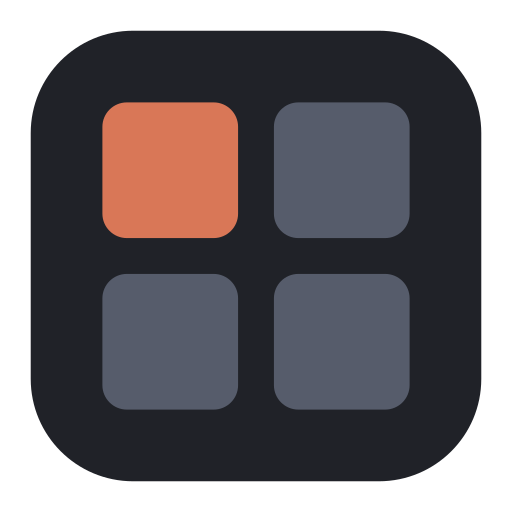
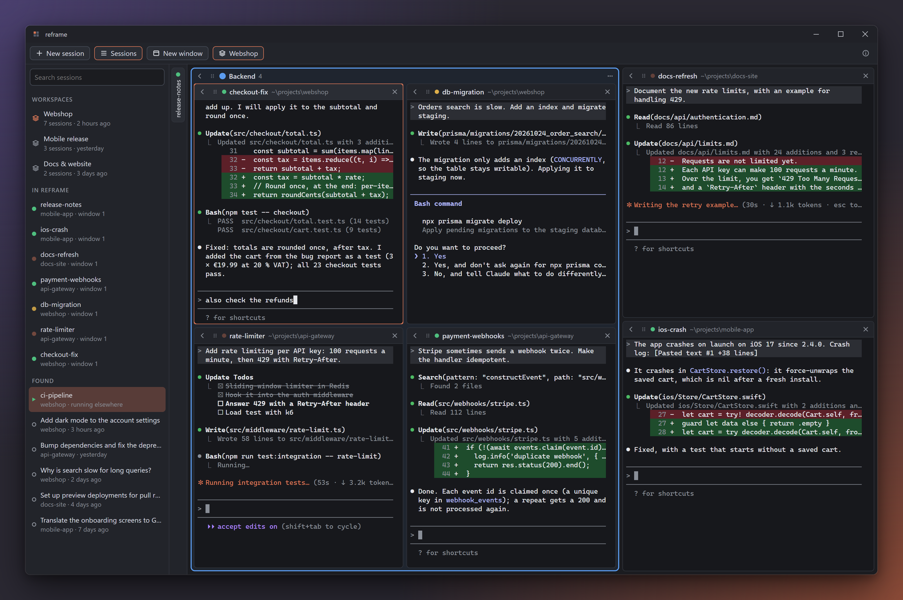
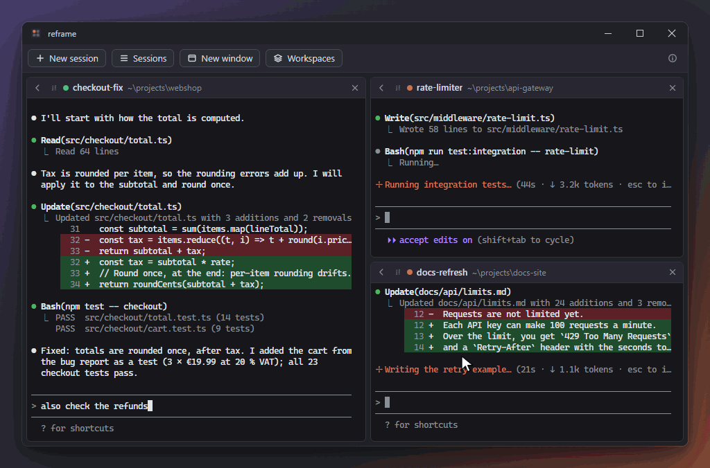
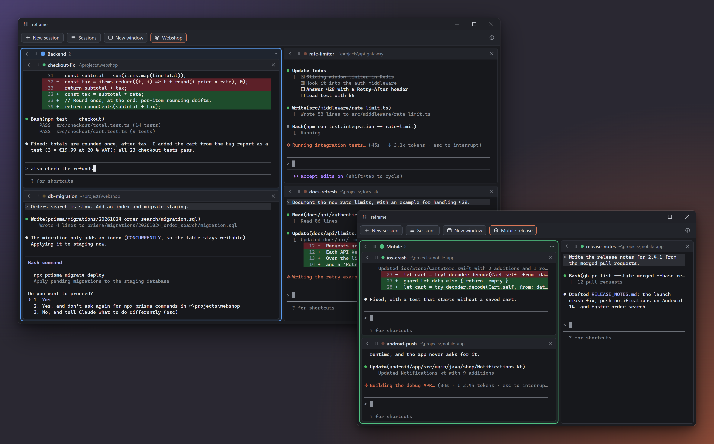
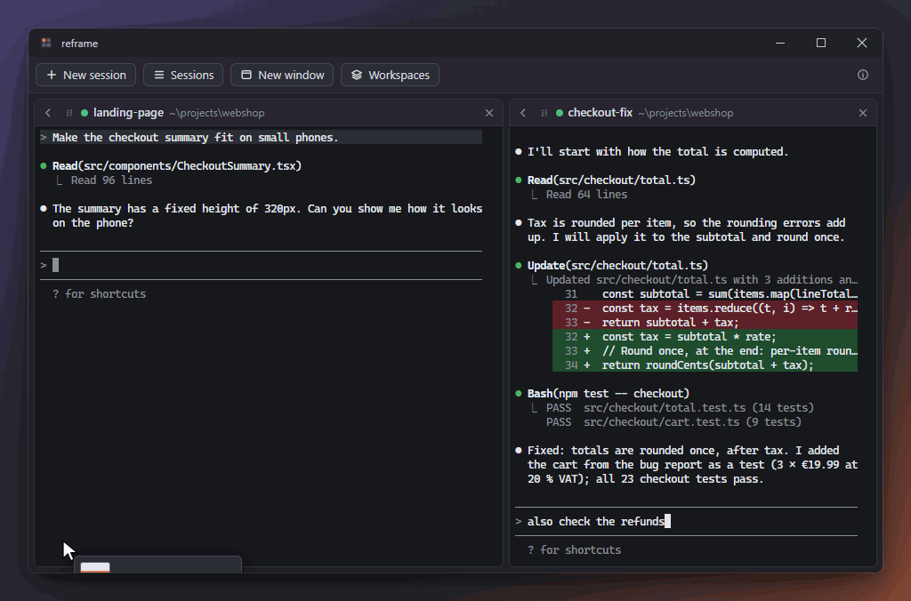
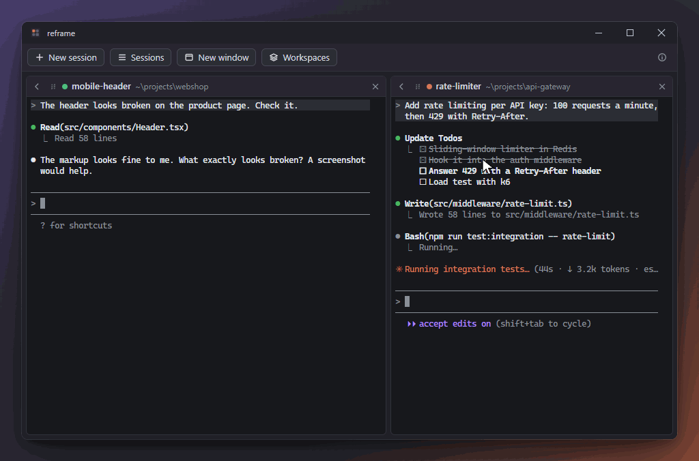

<p align="center">
  
</p>

<h1 align="center">reframe</h1>

<p align="center">
  Keep your <a href="https://claude.com/claude-code">Claude Code</a> sessions side by side in one window: tile and group them,<br>
  take over the ones running in other terminals, and get every session back after a restart.
</p>

<p align="center">
  <a href="https://theycallmejuzou.github.io/reframe/">Website</a> ·
  <a href="https://theycallmejuzou.github.io/reframe/download.html">Download</a>
</p>

<p align="center">
  
  <br>
  <sub>The pictures show made-up projects and sessions.</sub>
</p>

---

## What it does

- **All sessions in view.** Every session is a tile, and all tiles are visible at once, in two columns that fill in turn. Drag a tile's header onto another tile's edge to split next to it; the drop zone shows where it lands. Separators snap to a grid over the window as you drag them, so tiles line up (hold Alt to place one freely, or turn it off in Settings).

  

- **Out of the way when you want.** The arrow in a tile's corner collapses it into the side bar; a click puts it back where it was.
- **Groups.** Put tiles into a group (right-click a tile, or drag it onto a group): a colored frame with a name. A tile right next to the group stays where it is, and the frame grows around it. A group collapses, moves and leaves the window as one; dissolve it or end all its sessions from its menu.
- **Several windows.** Open a new, empty window (toolbar, tray or Ctrl+Shift+N), or drag a tile or a group out of the window and it gets a window of its own; drag it back, or into another window, whenever you like.
- **Workspaces.** Save a window under a name (Workspaces in the toolbar) and open it again later, as a window of its own with its tiles, groups and sessions, from the toolbar, the tray or the session list. F11 takes a window to full screen.

  

- **Session list.** The side bar on the left lists the sessions in reframe, the ones running in other terminals and your recent Claude Code sessions, with search. Click or drag one to open it: ended sessions resume, and sessions running elsewhere are taken over (ended there, continued here, history and name included). Select several with Shift or Ctrl+click and open them together from the right-click menu, also as a new group, here or in a new window. Sessions that turn up while reframe runs light up, and the Sessions button gets a dot while the list is hidden.
- **Pull terminal windows in** (Windows). Drag a Windows Terminal or console window (or just a tab of it) with a running `claude` onto reframe: after a short confirmation the session continues in reframe, at the spot you dropped it, and the terminal tab closes if nothing else runs in it.
- **WSL** (Windows). Start a session in a folder inside WSL (_Browse…_ → Linux, or type `\\wsl.localhost\Ubuntu\home\…`) and it runs the Claude Code installed in that distribution, shown as `Ubuntu ~/project`, with its status, notifications and resume after a restart like any other. Dropped files and pasted screenshots come in as Linux paths. The session list shows the sessions of running distributions too, past ones and ones running in a WSL terminal (taken over like any other); a distribution with Claude Code that is not running says so there, with a button to start it.
- **Files and screenshots.** Drop files onto a session to type in their paths (Claude Code attaches images among them); Ctrl+V pastes text, files you copied in Explorer or Finder, or a screenshot from the clipboard.

  

  

- **Nothing gets lost.** Every change is saved right away. Quitting from the tray ends the sessions cleanly, and the next start resumes each one (`claude --resume`) in its folder, in its place.
- **Runs in the background.** Closing a window with sessions asks whether to end them or keep them working in the tray (or does what you chose in Settings). In the tray they keep working, and you get a notification when Claude is done or needs you, unless you are looking at it anyway.
- **Starts with the system** if you like (tray menu), quietly in the tray, and **updates itself** from GitHub Releases.
- **Settings** (the ⚙ in the toolbar, or Ctrl+,): the language (English or German, or the system's), the text size, snapping to the grid, and checking for updates.

## Keyboard shortcuts

On macOS, use Cmd instead of Ctrl. Everything else goes to Claude Code as usual.

| Shortcut               | What it does                                                                                       |
| ---------------------- | -------------------------------------------------------------------------------------------------- |
| Ctrl+1 … 9             | Focus the first … ninth tile in the window                                                         |
| Ctrl+Shift+Arrow keys  | Focus the neighboring tile in that direction                                                       |
| Ctrl+Shift+M           | Collapse the focused tile; without a focused tile, bring back the last one                         |
| Ctrl+Shift+L           | Show or hide the session list (and search it)                                                      |
| Ctrl+Shift+T           | New session                                                                                        |
| Ctrl+Shift+N           | New window                                                                                         |
| F11                    | Full screen on and off                                                                             |
| Ctrl+,                 | Settings                                                                                           |
| Ctrl+= (or +) / Ctrl+- | Larger / smaller text in all terminals (also Ctrl+mouse wheel over a tile); Ctrl+0: back to normal |
| Ctrl+C / Ctrl+V        | Copy the selection (otherwise Ctrl+C goes to Claude) / paste text, copied files or an image        |

## Install

Download the installer for your system from the [website](https://theycallmejuzou.github.io/reframe/download.html) or [Releases](https://github.com/TheyCallMeJuzou/reframe/releases). You need [Claude Code](https://claude.com/claude-code) installed and logged in (`claude` on your `PATH`). On Windows, sessions in a WSL folder use the Claude Code installed in that distribution instead.

The builds are not code-signed yet, so the first start needs a confirmation:

- **Windows** (`reframe-Setup-<version>.exe`): installs for your user without admin rights. If SmartScreen warns, choose _More info_ → _Run anyway_.
- **Windows, portable** (`reframe-<version>-win-portable.zip`): unpack it anywhere (a USB stick, say) and start `reframe.exe`. It keeps its sessions, windows and settings in the folder `data` next to it and runs apart from an installed reframe. It does not update itself: it tells you when there is a new version to download. If you let it start with the system and move the folder later, turn that on again. Before unpacking, right-click the ZIP → _Properties_ → tick _Unblock_: otherwise Windows marks every unpacked file as downloaded, and SmartScreen asks on the first start.
- **macOS** (`.dmg`, Apple silicon): drag reframe into Applications, then right-click it → _Open_ the first time (or `xattr -dr com.apple.quarantine /Applications/reframe.app`). Updates on macOS need a signed build, so for now update by downloading the new version.
- **Linux**: the `.AppImage` (make it executable, then run it; it updates itself) or the `.deb`.

| Platform | Status                                                                                                                             |
| -------- | ---------------------------------------------------------------------------------------------------------------------------------- |
| Windows  | Everything above; this is where reframe is developed and tested.                                                                   |
| macOS    | Built in CI, not tested yet. Pulling terminal windows in is not available yet (use the session list to take sessions over).        |
| Linux    | Built in CI, not tested yet. Pulling terminal windows in is not available yet (planned for X11; on Wayland only the session list). |

### Uninstall

If you let reframe start with the system, turn that off in the tray menu first (from version 0.6.0 on, the Windows uninstaller does it for you). reframe never changes Claude Code's own settings files, so there is nothing to undo there.

- **Windows**: _Settings_ → _Apps_ → _Installed apps_ → reframe → _Uninstall_. Your sessions, windows and settings stay in `%APPDATA%\reframe`; delete that folder to remove them too.
- **Windows, portable**: quit reframe and delete its folder (its data is inside).
- **macOS**: quit reframe and move it from Applications to the Trash. Its data is in `~/Library/Application Support/reframe`.
- **Linux**: delete the AppImage, or remove the package (`sudo apt remove reframe`). Its data is in `~/.config/reframe`.

## Code signing policy

The Windows releases are going to be signed through the SignPath Foundation's free code signing for open source projects (being set up; until then they are unsigned, see [Install](#install)).

Free code signing provided by [SignPath.io](https://about.signpath.io/), certificate by [SignPath Foundation](https://signpath.org/).

- **What gets signed**: the Windows installer and `reframe.exe` in the portable ZIP, built by the [release workflow](.github/workflows/release.yml) on GitHub Actions from this repository's tagged source. Each release is signed only after an approver has approved it.
- **Committers and reviewers**: [TheyCallMeJuzou](https://github.com/TheyCallMeJuzou). Changes from anyone else come as pull requests and are merged only after a review.
- **Approvers**: [TheyCallMeJuzou](https://github.com/TheyCallMeJuzou)

The policy and the privacy policy below are also on the [website](https://theycallmejuzou.github.io/reframe/code-signing.html).

### Privacy

reframe collects nothing about you and sends nothing about you or your sessions anywhere. Its own use of the network:

- **Updates**: half a minute after starting and then every six hours, reframe asks [this repository's releases](https://github.com/TheyCallMeJuzou/reframe/releases) on GitHub whether there is a newer version. That is a plain web request, as when you open the page in a browser (GitHub sees your IP address, see [GitHub's privacy statement](https://docs.github.com/site-policy/privacy-policies/github-general-privacy-statement)). The installed Windows app and the AppImage then download the new version from there. You can turn this off in Settings (_Check for updates_, from version 0.6.0 on).
- **Links** you click (for example in About) open in your browser.

Claude Code, which reframe starts for you, talks to Anthropic the way you have set it up; for that, [Anthropic's privacy policy](https://www.anthropic.com/legal/privacy) applies.

## Development

Requirements: Node.js 24, and on Linux the tools to build [node-pty](https://github.com/microsoft/node-pty) (`python3`, `make`, a C++ compiler).

```sh
npm install        # install scripts are only allowed for node-pty and koffi (allowScripts in package.json)
npm run dev        # start with hot reload
npm test           # unit tests
npm run test:e2e   # builds, then runs the end-to-end tests against a fake claude
npm run typecheck && npm run lint
npm run dist       # installers for this system, into dist/ (npm run dist:dir: just the unpacked app)
npm run screenshots  # the pictures in this README, taken from the real app with demo sessions
```

`npm install` does not download Electron itself: it fetches its program the first time it runs (`npm run dev` or the tests), so that start needs a network connection. `npx install-electron` fetches it ahead of time.

A smoke test against the real CLI is opt-in (it starts real sessions; the hooks test sends one short prompt):

```sh
REFRAME_E2E_REAL=1 REFRAME_E2E_FOLDER=/path/to/a/trusted/folder npx playwright test real
```

See [CONTRIBUTING.md](CONTRIBUTING.md) for how to contribute and [docs/RELEASING.md](docs/RELEASING.md) for releases.

### Environment variables

| Variable                        | Purpose                                                                      |
| ------------------------------- | ---------------------------------------------------------------------------- |
| `REFRAME_USER_DATA`             | Use another profile directory (state, hook settings, log)                    |
| `REFRAME_CLAUDE_BIN`            | Path to the `claude` executable, or a `.js` stand-in                         |
| `REFRAME_NODE`                  | Node binary that runs a `.js` stand-in (needed on Windows)                   |
| `REFRAME_CLAUDE_HOME`           | Claude Code's config directory (default: `CLAUDE_CONFIG_DIR` or `~/.claude`) |
| `REFRAME_LOCALE`                | Force `en` or `de`                                                           |
| `REFRAME_DISABLE_NOTIFICATIONS` | Suppress OS notifications (tests)                                            |
| `REFRAME_E2E`                   | Exposes test hooks to the end-to-end tests (set by the tests)                |
| `REFRAME_E2E_APP`               | Run the end-to-end tests against a packaged app (e.g. `dist/win-unpacked/…`) |

The app log is in the profile directory, under `logs/main.log`.

## How it works

- The **main process** owns the state (`state.json` in the profile, written atomically with a backup) and applies the layout changes the windows ask for.
- A **PTY host** (`utilityProcess`) runs each `claude` in a pseudo terminal ([node-pty](https://github.com/microsoft/node-pty)) and mirrors its screen in a headless [xterm.js](https://xtermjs.org/), so any window can attach at any time and get the current screen. That is how tiles move between windows without restarting anything.
- **Status** comes from Claude Code's HTTP hooks (passed per session with `--settings`, merged with your own hooks; your settings files are never changed) and from Claude Code's session registry.
- **Taking over** a session that runs elsewhere ends it there the way you would (Ctrl+C), then resumes it in reframe under the same session id. On Windows, reframe follows window drags and new terminal windows (window events through [koffi](https://koffi.dev/)) and maps consoles to their terminal windows.

Design notes and findings (German): [docs/PLAN.md](docs/PLAN.md), [docs/PHASE0-FINDINGS.md](docs/PHASE0-FINDINGS.md).

## License

[MIT](LICENSE) © reframe Team

reframe is an independent open source project, not affiliated with or endorsed by Anthropic. Claude and Claude Code are trademarks of Anthropic.
